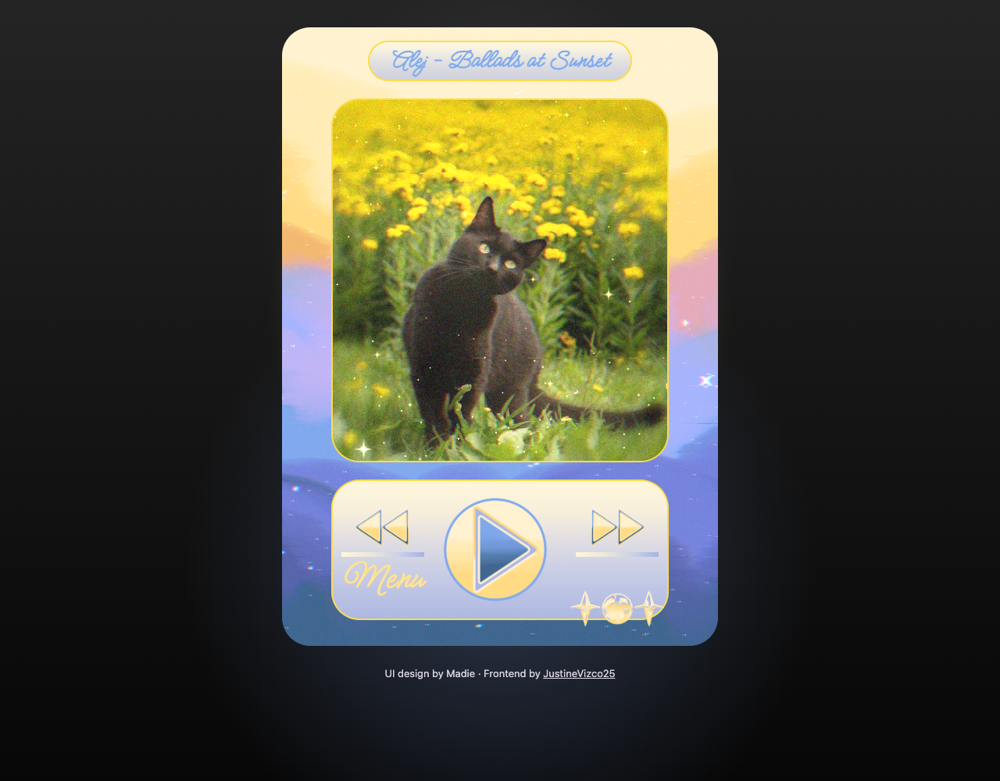
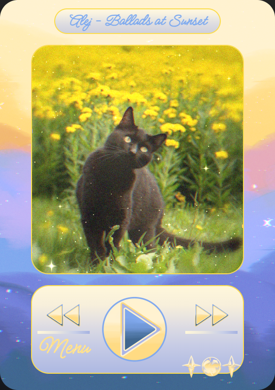
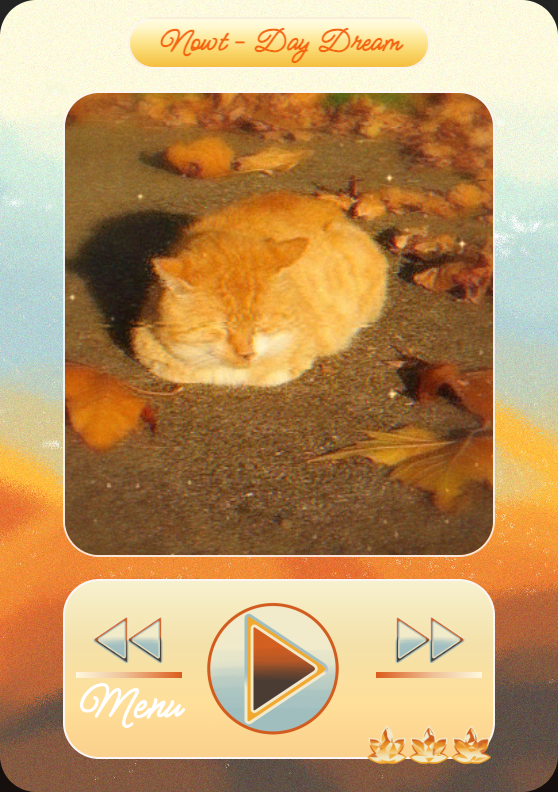
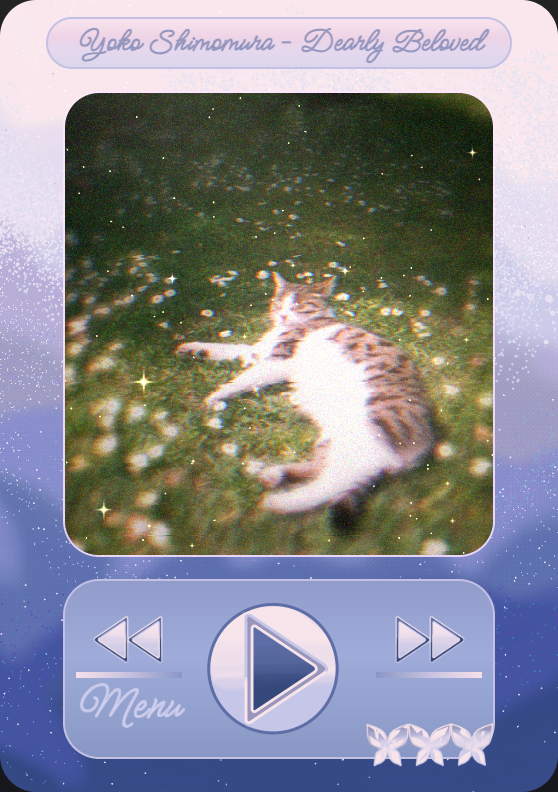
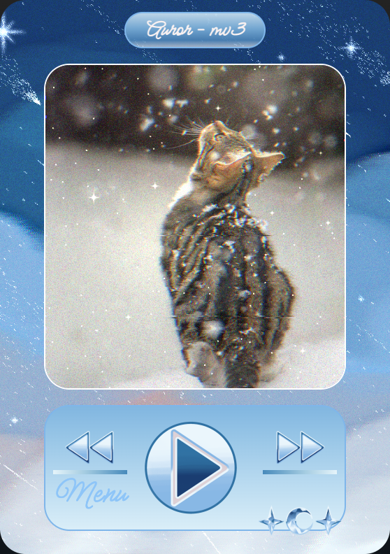
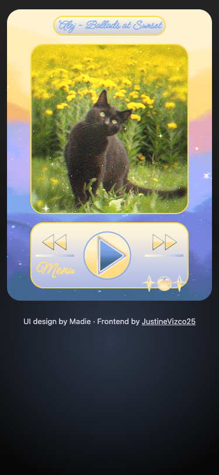
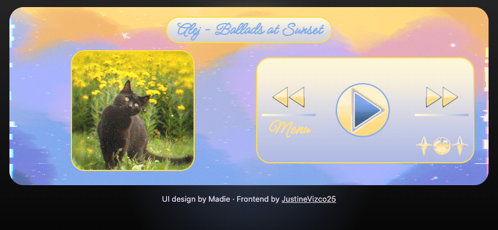

# Madie Music Player

A seasonal music player built with **HTML, CSS, and vanilla JavaScript**. Each song changes the cover artwork, background, illustrated controls, and color palette to match summer, autumn, spring, or winter.

**UI design: Madie · Frontend implementation: [JustineVizco25](https://github.com/JustineVizco25)**

The project is named after Madie to acknowledge her UI design. My contribution is translating that design into a working browser experience: layout, responsive behavior, playlist logic, audio playback, accessibility improvements, and browser tests.



## A quick walkthrough for reviewers

1. [Run the project locally](#run-locally) and press **Play**. The player starts paused so that playback begins with a user action.
2. Use **Next** and **Previous** to move through the 14-song playlist. Navigation wraps at both ends and keeps the current playing or paused state.
3. Open **Menu** and choose a track from another season. For example, **Day Dream** uses the autumn theme and **Solas** uses winter. The artwork and controls change together.
4. Resize the browser to a phone width, then try a short landscape window. The portrait card fits the available height, and the landscape layout puts the artwork beside the controls.
5. Try the same flow with **Tab**, **Enter**, and **Space**. Close the song menu with **Escape**; focus returns to Menu.

For a code review, start with [index.html](index.html), then the playlist and playback functions in [songs/index.js](songs/index.js), the layout in [index.css](index.css), and the behavior checks in [tests/player.spec.js](tests/player.spec.js).

## What this project demonstrates

| Frontend skill | Where it appears |
| --- | --- |
| Translating a UI design into code | Illustrated controls, layered cover artwork, gradients, and four coordinated seasonal appearances |
| Responsive CSS | A flowing grid, height-aware portrait sizing, a compact landscape layout, and titles that wrap safely with fallback fonts |
| DOM and event handling | Song selection, control updates, active playlist items, and theme changes without reloading the page |
| Browser audio APIs | One audio element, explicit playback, track transitions, automatic advancement, and error recovery |
| Asynchronous state management | Playback intent and request IDs prevent an old rejected play promise from resetting a newer track |
| Accessible interaction | Native buttons, descriptive control labels, visible keyboard focus, live status text, and a native modal dialog |
| Verification and source control | Playwright regression tests, GitHub Actions, and commits separating the original implementation, fixes, tests, and documentation |

## Features

- 14 local tracks across four seasonal themes.
- Play/pause, previous/next, and automatic advancement when a track ends.
- A song menu that highlights the current selection.
- Matching cover art, background, navigation icons, play/pause icons, borders, and gradients.
- Portrait and landscape layouts checked across 11 window sizes, from 280×653 to 1440×900, with the design font and fallback fonts.
- Messages for blocked playback and missing or unplayable audio.
- Visible credit for the designer and frontend developer.

<table>
  <tr>
    <td></td>
    <td></td>
    <td></td>
    <td></td>
  </tr>
</table>

## Run locally

You need **Node.js 22 or newer** and npm for the development commands. There is no build step or backend.

```bash
git clone https://github.com/JustineVizco25/madie-music-player.git
cd madie-music-player
npm ci
npm start
```

Open **http://127.0.0.1:4173**. Stop the server with **Ctrl+C**.

The application itself has no JavaScript framework or runtime package dependencies. The npm packages provide a local static server and browser tests. Google Fonts supplies the Meow Script typeface; the stylesheet includes a cursive fallback.

<details>
<summary>Phone previews: portrait and landscape</summary>





</details>

## How it works

The `songs` array in [songs/index.js](songs/index.js) contains track metadata, local asset paths, and seasonal styles. `loadSong()` reads the selected entry and updates the existing player instead of creating a new player for each track.

One `HTMLAudioElement` handles the playlist. `isPlaybackRequested` records whether the listener wants playback to continue, including while the browser is still loading audio. A request counter identifies the current `play()` attempt. If an older attempt rejects after a track change or pause, its result is ignored. Current failures reset the control and display a recovery message.

Previous and next use wraparound indices. The audio element's `ended` event selects the next track and starts it. Selecting a song from Menu preserves the current playback intent. Selecting the already active song leaves its playback position alone.

The player uses CSS Grid so the song title, cover, and controls occupy separate layout areas. The portrait card retains the original proportions and sizes itself using both the available width and window height. Short landscape windows use a two-column arrangement with the cover beside the controls. Titles can wrap when the design font is unavailable without overlapping the artwork. A native `<dialog>` supplies modal focus behavior and Escape handling; song titles and playback messages use live status regions.

## Project structure

```text
madie-music-player/
├── index.html               # Semantic page, playback buttons, and song dialog
├── index.css                # Responsive layout and presentation
├── songs/
│   ├── index.js             # Playlist data, rendering, and audio behavior
│   └── *.mp3                # Local audio files
├── icons/                   # Four sets of illustrated controls
├── music_backgrounds/       # Seasonal backgrounds
├── music_cover_photos/      # Track artwork
├── tests/player.spec.js     # Browser regression checks
├── playwright.config.js     # Test browser and local server configuration
├── docs/screenshots/        # Actual browser screenshots
└── .github/workflows/ci.yml # Automated syntax and browser checks
```

## Checks and tests

```bash
npm run check
npx playwright install chromium
npm test
```

The browser suite covers:

- Real audio playback, elapsed time, and pausing.
- Track changes while playing and paused, wraparound, and automatic advancement at the end of a track.
- Keyboard operation, menu selection, Escape dismissal, and focus restoration.
- Blocked playback, a missing audio file, and recovery.
- Rejected promises from an obsolete or cancelled playback request.
- Every configured asset path, audio metadata decoding, and image decoding.
- Horizontal and vertical layout bounds, content overlap, and minimum 44px control targets at 11 portrait and landscape window sizes, both with and without Google Fonts.

GitHub Actions runs the syntax check and browser suite for pushes and pull requests. Automated browser coverage uses Chromium; it does not establish identical behavior across every browser or device.

## Issues addressed before publishing

| Finding | Change |
| --- | --- |
| The fixed-width player extended beyond phone viewports, and controls fell below short windows | Added a fluid grid, height-aware portrait sizing, a compact landscape arrangement, and viewport metadata |
| Long song titles could collide with the cover, including when Google Fonts failed | Gave titles their own grid row so wrapping adjusts the cover space; checked every song with both font-loading outcomes |
| Images and divs acted as controls without keyboard access | Added native buttons, accessible names, and visible focus indicators |
| Menu was a visual label with no action | Connected it to a keyboard-accessible song dialog |
| Playback failures had no explanation | Added status messages and a usable recovery path |
| An older rejected play request could reset the current control | Tracked playback intent and ignored obsolete promise results |
| Icon paths used a trailing-space folder name, and play/pause filenames described the opposite symbols | Renamed the folder to `icons/` and aligned filenames and references with the displayed symbols |

## Scope and next steps

This is a frontend portfolio project with a local playlist. It has no account system, streaming API, search service, or backend. Seeking, a progress display, volume controls, and shuffle/repeat controls are potential additions.

Further improvements would include consolidating repeated seasonal style data, reducing image and audio transfer sizes, and adding Firefox, WebKit, and physical-device checks.

## Credits

- **UI design and project namesake:** Madie.
- **Frontend implementation:** [JustineVizco25](https://github.com/JustineVizco25).
- **Music:** The artists named in the playlist, including Alej, Jvke, Nowt, Juan Arenosa, BAANDIT, Yoko Shimomura, Txmy, 照井順政, Auror, Jamie Duffy, and Jordan Critz. Music and artwork belong to their respective creators.
- **Typeface:** Meow Script, loaded through Google Fonts.
